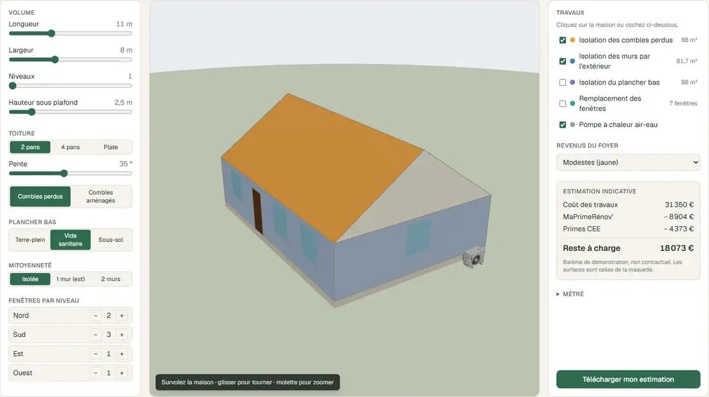
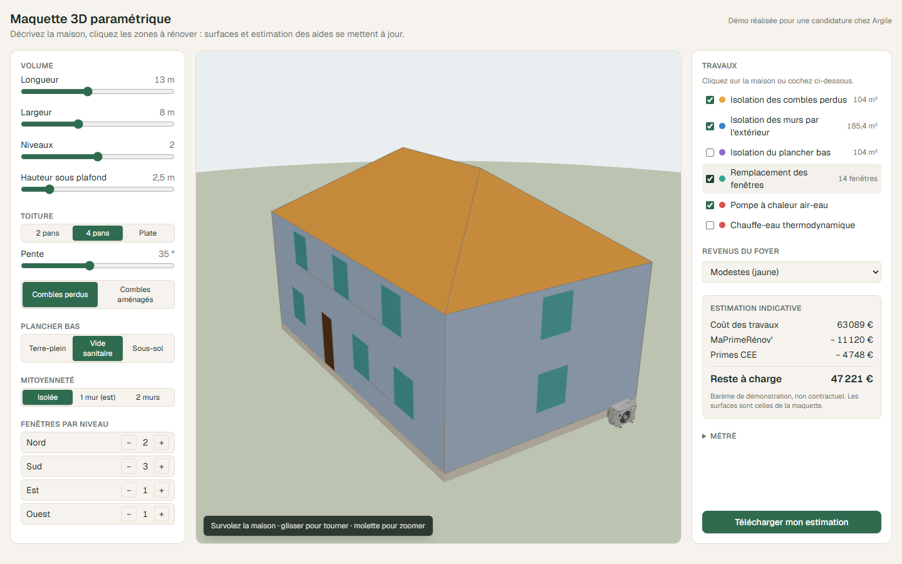
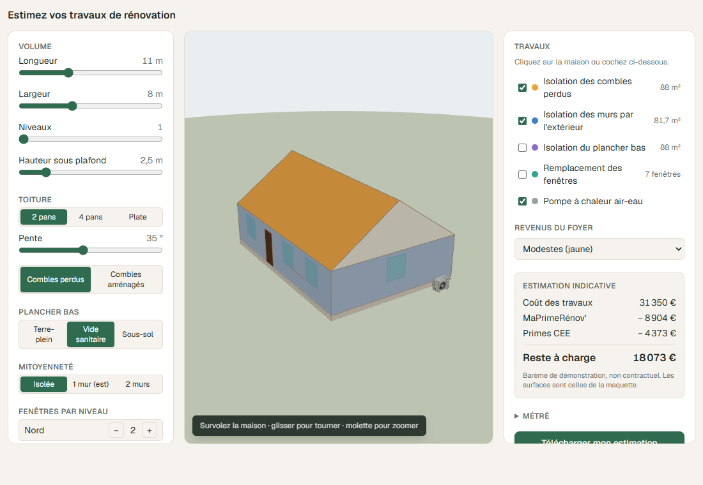

# argile-demo — maquette 3D paramétrique

Projet de démonstration pour une candidature chez **Argile** (SaaS pour les artisans RGE de la rénovation énergétique).
**Démo en ligne : https://argile-demo.vercel.app** · version intégrable : https://argile-demo.vercel.app/embed

Poste : [développeur full-stack](https://www.welcometothejungle.com/fr/companies/remi/jobs/eb8dcc21-ed78-4502-8cf0-3ea0d488e583), CDI, Paris.

Argile intègre une reconstruction 3D du logement et un simulateur d'aides intégrable au site des artisans. Cette démo relie les deux. On décrit une maison en quelques paramètres et on la voit en 3D. Un clic sur les zones à rénover suffit : **le métré et l'estimation des aides se recalculent à partir de la géométrie**.



| Maison à étage, toit 4 pans | Version intégrable (`/embed`) |
| --- | --- |
|  |  |

## Fonctionnalités

- **Configurateur** : dimensions, niveaux, toiture 2 pans / 4 pans / plate, pente, combles perdus ou aménagés, plancher bas, mitoyenneté, fenêtres par façade. Les paramètres incohérents sont refusés avec un message, et la maquette garde alors le dernier état valide.
- **Vue 3D** (react-three-fiber) :
  - le survol d'une zone affiche sa surface et le poste de travaux associé ;
  - un clic ajoute ou retire ce poste ;
  - toutes les zones d'un même poste se colorent ensemble.
- **Métré** : murs bruts, nets et mitoyens, ouvertures, pignons, rampants, plancher des combles, toiture-terrasse, plancher bas.
- **Estimation indicative** : coût, MaPrimeRénov' par tranche de revenus, primes CEE, plafonds par poste, écrêtement et reste à charge.
- **Projets enregistrés** en Postgres, avec une URL partageable `/projets/[id]`. Le serveur revalide l'entrée et **recalcule** surfaces et estimation : on ne fait pas confiance au client.
- **Version intégrable** sur `/embed` (en-tête `frame-ancestors *`), avec le snippet iframe affiché sur la page d'accueil.

## Architecture

```
src/lib/house/       géométrie paramétrique : fonctions pures, sans three.js
  params.ts          schéma zod + règles de cohérence (ouvertures, mitoyenneté…)
  geometry.ts        buildHouse(params) → zones planes (repère origin/u/v + contour 2D + trous)
  surfaces.ts        aires exactes par zone (formule du lacet) et totaux du métré
src/lib/estimate/    zones → postes de travaux, barème, estimation et écrêtement
src/components/house three.js uniquement pour l'affichage : ShapeGeometry + matrice du repère
src/db/              Drizzle : tables bareme et projects ; PGlite en local, Neon en prod
blender/             oracle de surfaces (voir ci-dessous)
fixtures/            cas de référence et aires mesurées par Blender
```

Le choix structurant : **chaque zone est un polygone plan décrit dans son propre repère orthonormé**. Une même donnée sert à la fois au calcul exact des aires en 2D et au rendu 3D, sans dupliquer la géométrie.

## Les tests, et un oracle Blender

```bash
npm test
```

- **Cas calculés à la main** : boîte, 2 pans à 45°, 4 pans, plan carré.
- **Invariants** sur des maisons variées :
  - surface de toiture = emprise / cos(pente) ;
  - normales unitaires et orientées vers l'extérieur ;
  - ouvertures dans leur mur, sans chevauchement.
- **Estimation** : plafonds par poste, écrêtement, transposition du poste toiture quand le toit change.
- **Oracle Blender** : `blender/house_oracle.py` reconstruit chaque cas de `fixtures/cases.json` face par face, en 3D (axe z vertical, sans repère 2D ni formule du lacet), et mesure les aires avec `bmesh`. `surfaces.oracle.test.ts` exige l'accord des deux implémentations à 0,01 % près. Pour régénérer les mesures :

```bash
npm run oracle
```

Cette commande demande `blender` dans le PATH. Le script fonctionne aussi depuis le MCP Blender via `run(cases, out)`.

## Lancer en local

```bash
npm install
```

```bash
npm run dev
```

Pour régénérer les captures et l'animation du README, le serveur de dev doit tourner :

```bash
npm run capture
```

Aucune base à installer : PGlite crée `.pglite/`, applique les migrations et charge le barème au premier appel.

## Déployer (Vercel + Neon)

1. Importer le dépôt GitHub dans Vercel (Add New → Project). Le framework Next.js est détecté tout seul.
2. Dans le projet Vercel, ouvrir Storage → Create Database → **Neon**. L'intégration crée la base et ajoute `DATABASE_URL` aux variables d'environnement.
3. Redéployer. Ensuite, chaque push sur `main` déploie en production, et chaque autre branche obtient une URL de preview. Le script `vercel-build` applique les migrations et charge le barème (`src/db/migrate.ts`), puis lance `next build`.

Sur Vercel, l'app utilise Neon via `DATABASE_URL`. En local, elle reste sur PGlite même si `vercel env pull` a écrit `DATABASE_URL` dans `.env.local` : il faut `USE_NEON=1` pour viser Neon, ce qui évite de remplir la base de production avec des projets de test.

## Équipements 3D (Tripo3D → Blender → web)

L'unité extérieure de PAC (`public/models/pac.glb`, 584 Ko) a été produite par une chaîne entièrement scriptée. Le modèle généré sert au rendu, jamais à la mesure.

1. **Génération** avec [Tripo CLI](https://www.npmjs.com/package/tripo-cli) : text-to-model v3.1 texturé PBR, puis réduction à 20 000 faces. Coût : 50 crédits API.

```bash
tripo make "outdoor unit of an air-to-water heat pump, white metal casing, single large round fan grille on the front left, side service panel on the right, realistic residential appliance" --then decimate:20000 -p texture=true -p pbr=true -o assets/tripo/pac
```

2. **Normalisation** dans Blender (`blender/normalize_asset.py`) :
   - rotation pour mettre la grille vers l'avant (+Z en glTF) ;
   - échelle uniforme pour obtenir 1,0 m de large, soit 1,00 × 0,67 × 0,49 m ;
   - origine centrée au sol, puis rendus de contrôle sous 5 angles.

```bash
blender -b --factory-startup -P blender/normalize_asset.py -- assets/tripo/pac/tripo-out/<tâche>/model.glb assets/tripo/pac/norm/pac.glb --width 1.0 --rot-z -90 --views assets/tripo/pac/norm/views
```

3. **Compression** en meshopt avec des textures WebP 1024 px, ce qui fait passer le fichier de 3,1 Mo à 584 Ko :

```bash
npx @gltf-transform/cli optimize assets/tripo/pac/norm/pac.glb public/models/pac.glb --compress meshopt --texture-compress webp --texture-size 1024
```

Les fichiers bruts restent dans `assets/tripo/`, ignoré par git. Si le modèle ne se charge pas, la scène retombe sur un volume aux mêmes dimensions.

## Limites assumées

- **Barème de démonstration** : ordres de grandeur inspirés des forfaits par geste, pas les montants officiels. La tranche de revenus est choisie directement, sans calcul à partir du revenu fiscal.
- **Volume simple** : un rectangle, faîtage parallèle à la longueur, ouvertures de taille standard, sans débord de toit ni lucarne.
- **Assets non métriques** : les modèles générés par IA servent au rendu, jamais à la mesure.

## Étapes

- [x] Socle Next.js, Drizzle, Vitest
- [x] Géométrie paramétrique et métré, testés
- [x] Oracle Blender et fixtures
- [x] Estimation et barème en base
- [x] Vue 3D interactive et configurateur
- [x] Projets enregistrés, page partageable, version `/embed`
- [x] Modèle de PAC Tripo3D, optimisé pour le web
- [x] Captures d'écran et animation (`npm run capture`)
- [x] Déploiement Vercel + Neon
